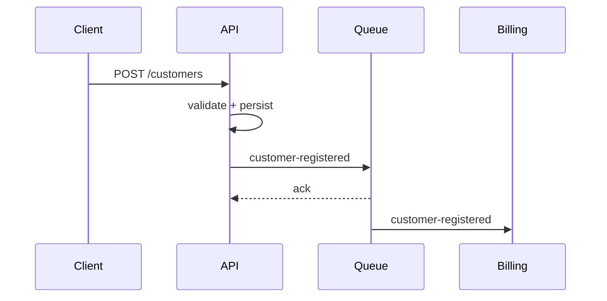
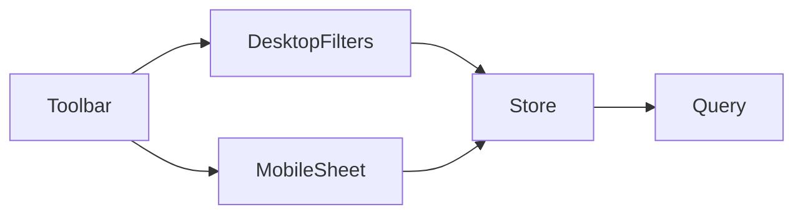
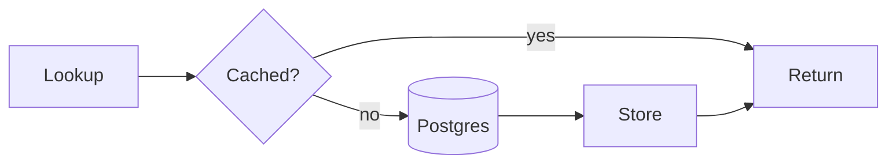
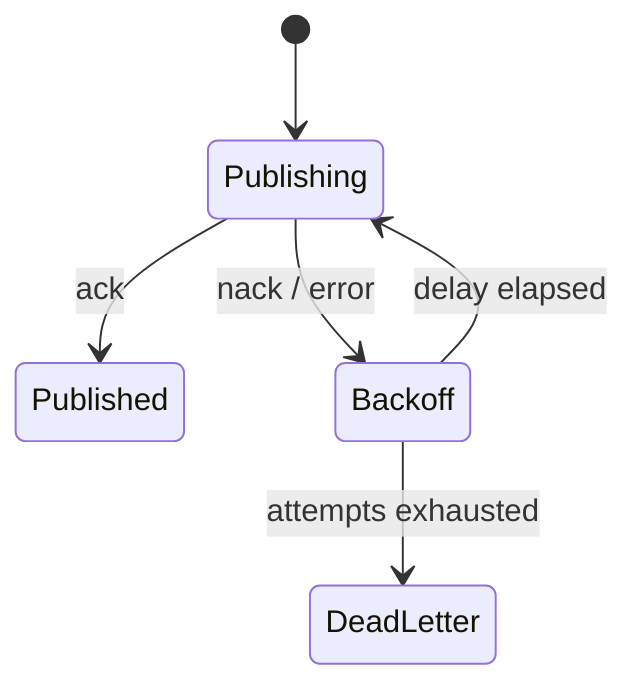
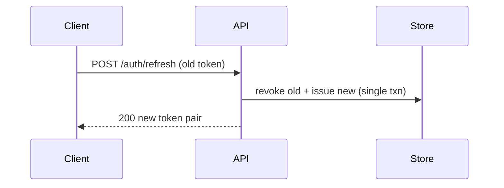

# PR Body Examples

## Feature: customer registration emits an event

```markdown
Adds a `customer-registered` event so downstream services stop polling the customers table.

### Flow



### Key code

`internal/events/customer.go` — the event is published after commit, not inside the transaction, so a rolled-back insert never produces an event.

```go
func (s *Service) Create(ctx context.Context, in CreateInput) (*Customer, error) {
    c, err := s.repo.Insert(ctx, in)
    if err != nil {
        return nil, err
    }
    return c, s.events.Publish(ctx, customerRegistered(c))
}
```

Consumer usage:

```go
bus.Subscribe("customer-registered", func(e events.CustomerRegistered) error {
    return billing.CreateAccount(ctx, e.CustomerID)
})
```

### Notes

- `events` package is new — `internal/events/`.
- Existing polling job is left in place until all consumers migrate; removal is a separate PR.
```

## UI change: dashboard filter bar

```markdown
### Before / after

| Before | After |
|--------|-------|
|  |  |

Filters collapse into a sheet under 768px; the "Apply" button no longer sits off-screen on mobile.

Full page at 1280 px, default data set. Both screenshots are the rendered app, not component previews —
the regression here is layout, which a cropped shot would hide.

### Structure


```

## Benchmark: order lookup caching

```markdown
Caches order lookups by ID; the read path was re-querying the same rows on every retry.

| Scenario | `master` | This PR | Delta |
|----------|----------|---------|-------|
| p50 lookup | 12 ms | 0.9 ms | −93% |
| p99 lookup | 310 ms | 41 ms | −87% |
| Throughput | 800 req/s | 3,100 req/s | +288% |
| Memory (steady) | 180 MB | 205 MB | +14% |

Command: `go test ./internal/orders -bench=Lookup -benchtime=30s`

Tradeoff: 25 MB of steady-state memory for the hit rate shown above.

### Cache path


```

## Stacked PR: event pipeline

Stacked PRs are small and each targets its parent branch:

1. `alice/ref/pipeline/extract-publisher`
2. `alice/feat/pipeline/retry-policy`
3. `alice/feat/pipeline/dead-letter-queue`

Each body describes only its own layer, and links the one below:

```markdown
Depends on #412.

Adds exponential backoff with jitter to the publisher. The base layer (#412) extracted
`Publisher` so the retry logic is testable without a broker.



### Behavior

- Max 5 attempts; delays 100 ms → 1.6 s with ±20% jitter.
- `DeadLetter` is a no-op shim until #414 lands.
```

## Sloppy vs review-ready

Sloppy:

```markdown
## Summary
This PR implements the requested changes to improve the authentication flow.
I ran the tests and everything passes. Also fixed some other things along the way.
The diff is large but most of it is refactoring. Let me know if you have questions!
```

Why it fails: no what/why, unverifiable test claim, mixed concerns, effort narration, no entry point for review.

Review-ready:

````markdown
Adds refresh-token rotation so a stolen token expires after one use.

- `internal/auth/rotate.go` — `Rotate()` issues a new pair and revokes the old one atomically.
- Session middleware reads the rotated pair from the same cookie; no client change.
- Old tokens are accepted once during a 30 s grace window to avoid racing parallel requests.


````

Same size, but a reviewer knows where to start and what to verify.

## Typo fix

```markdown
Fixes "recieve" → "receive" in the login error shown to users.
```

No diagram, screenshot, table, or bullet list. One sentence is the whole review.
